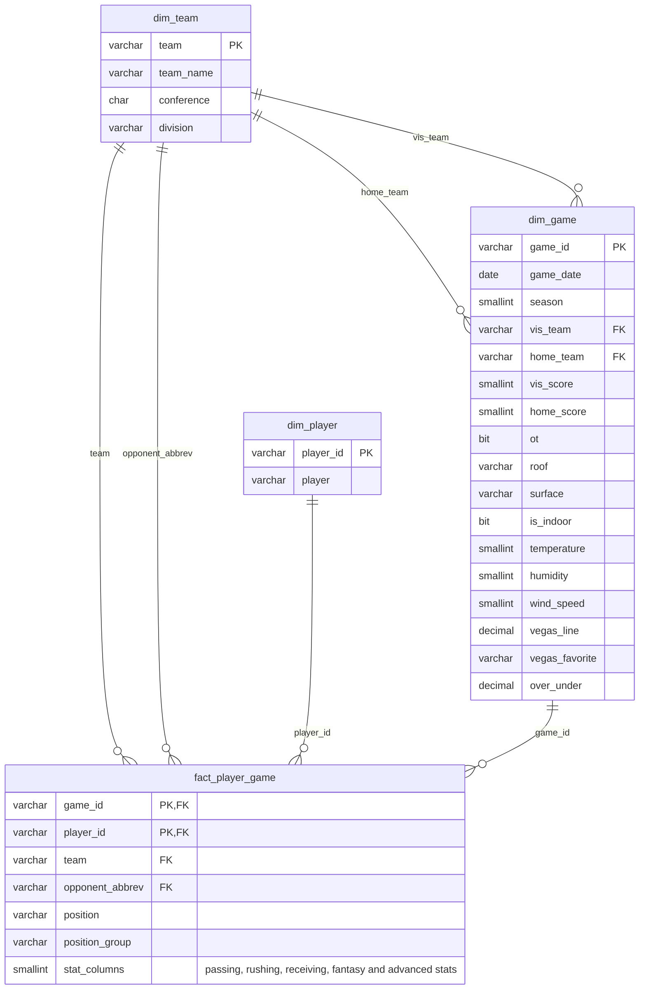

# NFL Star Schema (ERD)

## Views
- `vw_player_game` joins `fact_player_game` to `dim_player` and `dim_game`, and derives `is_home` and `team_spread`.
- `vw_game` reads `dim_game` and derives total points, margin, winner, and over/under and spread results.
